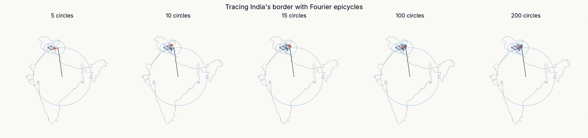
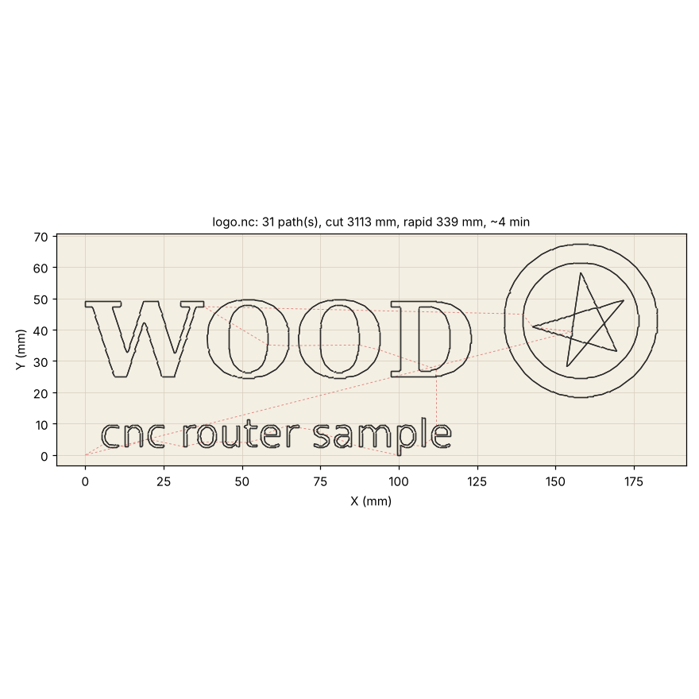

# Fourier Transform use cases

Two small, self-contained projects that put the discrete Fourier
transform to work on real shapes: one to watch it, one to cut wood with it.

| folder | what it is |
| --- | --- |
| [`fourier-india/`](fourier-india/) | India's border redrawn by a chain of rotating circles (Fourier epicycles). Python script that renders GIF/MP4, plus a browser page where you pick 5, 10, 15, 100, 200 or any number of circles. |
| [`image-to-cnc/`](image-to-cnc/) | A picture in, G-code for a wood CNC router out. Python script and a browser app. Uses the Fourier low-pass to smooth traced outlines, and explains where the transform helps a CNC pipeline and where it does not. |

## 1. Tracing India's border with epicycles



The border is read as a closed curve of complex numbers and transformed.
Every coefficient is a circle: radius `|c[k]|`, start angle `arg(c[k])`,
turning `k` times per lap. Chained largest first, the tip of the last arm
redraws the border, and the number of circles you keep is the level of
detail: 5 give a blob, 15 give the peninsula, 100 follow the coast, 200
pick up the Rann of Kutch and the Sundarbans.

```bash
cd fourier-india
pip install numpy matplotlib
python fourier_india.py                               # 5/10/15/100/200 side by side -> fourier_india.gif
python fourier_india.py --circles 100 -o india_100.mp4
```

Open `fourier-india/india_epicycles.html` in a browser for the
interactive version. The border comes from Natural Earth (public domain),
India point-of-view edition, mainland only.

## 2. Image to CNC toolpath



`image_to_gcode.py` turns a black-on-white picture into closed cutting
loops ordered for short tool travel, or a photo into one continuous line
that never lifts the tool. Output is plain GRBL G-code with a preview
drawn from the file itself.

```bash
cd image-to-cnc
pip install numpy opencv-python-headless matplotlib
python image_to_gcode.py samples/logo.png -o logo.nc --width-mm 200 --depth 1.5 --stepdown 0.8
python image_to_gcode.py samples/logo.png -o logo.nc --smooth 50        # Fourier-smoothed outlines
python image_to_gcode.py photo.jpg -o photo.nc --mode singleline --points 8000
```

`image_to_cnc.html` is the same converter as a single web page: open it
in any browser, drop a picture on it, download the G-code. Nothing is
uploaded anywhere.

### Is the Fourier transform useful for CNC?

Not as a toolpath format: a controller only follows straight lines and
arcs, a series describes exactly one closed curve, and it rounds and
overshoots every corner. Yes as a filter: dropping the high frequencies
of a traced outline removes pixel stair-steps and gives one knob for
detail, which is exactly the number of circles in the animation. The
full argument, with pictures, is in
[`image-to-cnc/README.md`](image-to-cnc/README.md).

## Requirements

Python 3.10 or newer, `numpy`, `matplotlib`; `opencv-python-headless` for
the CNC script; `ffmpeg` only for MP4 output. The two HTML pages need
nothing but a browser.
