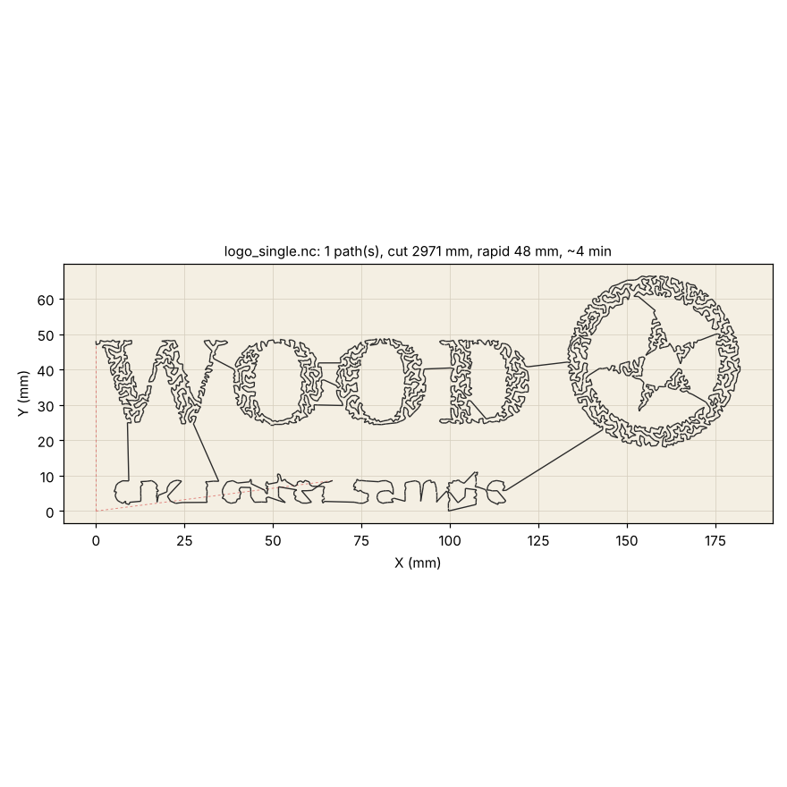
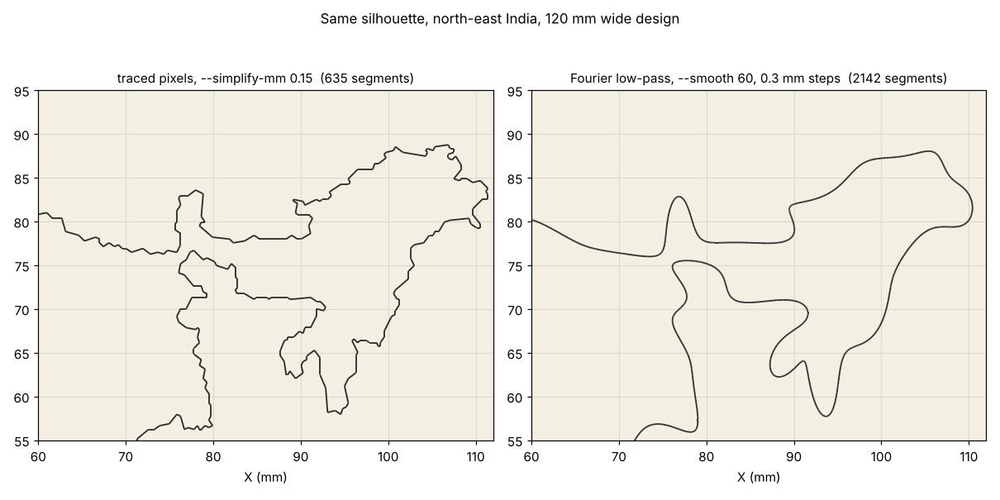

# Image to CNC toolpath

`image_to_gcode.py` turns a picture into G-code for a wood CNC router or
engraver. No CAM program, no manual tracing: one command in, one `.nc`
file out, plus a PNG preview of exactly what the machine will cut.

```bash
pip install numpy opencv-python-headless matplotlib

# black-on-white logo, lettering, silhouette -> outlines, 150 mm wide, 1 mm deep
python image_to_gcode.py logo.png -o logo.nc

# the same, with Fourier-smoothed outlines and two 0.8 mm passes
python image_to_gcode.py logo.png -o logo.nc --smooth 50 --depth 1.5 --stepdown 0.8

# a photo as ONE continuous line that never lifts
python image_to_gcode.py portrait.jpg -o portrait.nc --mode singleline --points 8000
```

## Two modes

| mode | what it does | use it for |
| --- | --- | --- |
| `contours` (default) | dark areas are the design; every outline and every hole becomes a closed loop; loops are ordered to keep the tool's travel short | logos, lettering, silhouettes, clip-art, line drawings |
| `singleline` | the whole picture becomes one open line that never lifts: dense where the image is dark, sparse where it is light, joined into a single tour ("TSP art") | portraits, photos, anything with shading |




Black lines are cuts, red dashes are rapid moves with the tool raised.

## Options that matter

| flag | default | meaning |
| --- | --- | --- |
| `--width-mm` | 150 | width of the finished design; height follows the image |
| `--origin` | corner | `corner` puts X0 Y0 at the bottom-left of the design, `center` in its middle |
| `--threshold` | auto | `auto` is Otsu's threshold; or 0-255, darker = design |
| `--invert` | off | light areas are the design |
| `--blur` | 1 | pixel blur before tracing, kills JPEG speckle |
| `--simplify-mm` | 0.15 | how far the polyline may stray from the traced pixels |
| `--min-length-mm` | 3 | drop outlines shorter than this (dust) |
| `--smooth` | 0 | Fourier low-pass per outline: keep this many harmonics (30-80 works well) |
| `--points` | 3000 | dots in singleline mode; 6000-12000 for a recognisable portrait |
| `--gamma` | 1.6 | contrast of the dot density, higher = emptier light areas |
| `--depth` | 1 | total cut depth, mm |
| `--stepdown` | 0 | depth per pass, 0 = everything in one pass |
| `--safe-z` | 5 | clearance height for rapids |
| `--feed`, `--plunge` | 800, 300 | XY and Z feed rates, mm/min |
| `--spindle` | 10000 | rpm for `M3`; 0 writes no spindle commands |
| `--svg` | | also write the cut path as an SVG for Inkscape or another CAM |

The G-code is plain GRBL dialect (`G21 G90 G17 G94`, `G0`, `G1`, `M3`,
`M5`, `M30`), Z0 on the top of the stock, negative into the wood. It
loads straight into bCNC, UGS, Candle, cncjs, LinuxCNC and most hobby
controllers. The preview is produced by re-reading the `.nc` file, so it
shows what was written, not what was intended.

## What it does not do

* **No tool-radius offset.** The cutter runs along the drawn line, as an
  engraver or V-bit does. For a cut-out (a shape you want to fall out of
  the board at its real size) the path must be offset outward by the
  tool radius; do that in your CAM program, or trace at
  `--width-mm` plus one tool diameter and accept the error.
* **No pocketing.** Filled areas are outlined, not cleared.
* **No arcs.** Everything is `G1` straight segments. With `--simplify-mm 0.15`
  that is far below what a wood cutter can resolve.

## Where the Fourier transform fits (and where it does not)

The `fourier-india/` animation in this repository draws a shape as a sum
of rotating circles. The obvious question is whether a CNC machine can
cut from that. The honest answer:

**Not as a toolpath format.** A controller moves the tool in straight
lines (`G1`) and arcs (`G2`/`G3`), and nothing else. A Fourier series
would have to be sampled back into straight segments before the machine
could follow it, which is exactly what the tracing step already produces.
A Fourier series also describes exactly one closed curve; a real design
has dozens of separate outlines, holes, and open strokes. And it hates
corners: a low number of harmonics rounds every corner off and makes the
curve ring (overshoot) on either side of it, the Gibbs effect you can see
in the 15-circle panel of the India animation.

**Useful as a filter.** A bitmap outline is jagged at pixel scale, and a
router following pixel stair-steps chatters and leaves a rough edge.
Dropping the high frequencies of the outline (`--smooth N`) is a very
good smoother: it keeps the overall shape, removes the noise, and gives
you one knob for "how much detail". That is the same knob as the number
of circles in the animation. It works best on organic shapes (leaves,
animals, maps, script lettering) and worst on shapes with sharp corners
(block letters, gears), where plain polyline simplification is better.

Compare the two on the India silhouette: `--smooth 60` turns the traced
pixel contour into a smooth path sampled every 0.3 mm, with no
stair-steps and 18% less cutting length, while the coastline is still
recognisable. The right-hand path has more segments, but they are short
and the direction changes gently, which is what the router wants.



## Preparing a picture

The converter can only cut what it can see, so most of the work is in the
picture:

1. **Contours mode wants black on white.** Flat, filled shapes, no
   gradients, no anti-aliased grey halos. Export logos from the vector
   original if you have one. If the design is white on dark, add
   `--invert`.
2. **Singleline mode wants a plain light background** and good contrast
   on the subject. Crop tight, raise the contrast, blur away film grain.
3. **Mind the tool.** A 60° V-bit engraving 1 mm deep makes a 1.15 mm wide
   groove; features closer together than that merge. Scale the design
   (`--width-mm`) so the smallest detail is a couple of tool widths.
4. **Always look at the preview before you start the spindle.** Check
   the size on the axes, the number of paths, and that the rapids (red)
   do not cross anything that is sticking up (clamps).
